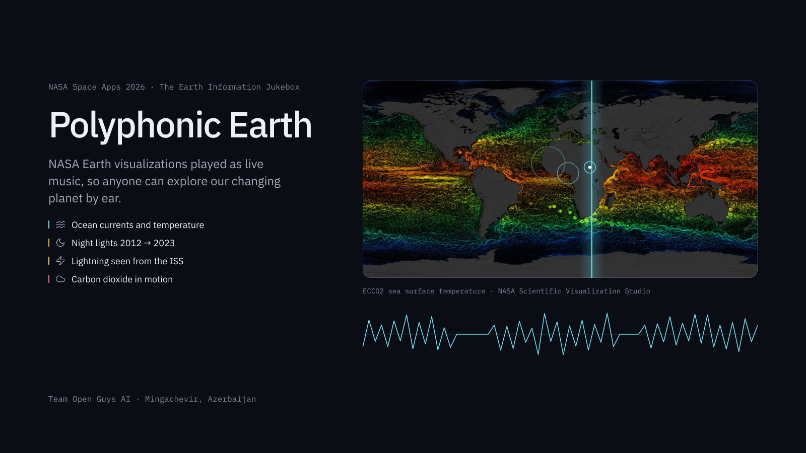

# 🌍🎵 Polyphonic Earth



**Hear our planet change.** Polyphonic Earth is an accessible *Earth Jukebox*. It turns NASA Earth Information Center (EIC) visualizations into live music in the browser, so anyone can explore Earth science with their ears, including people who are blind or have low vision.

Built for the **2026 NASA Space Apps Challenge**, challenge *"The Earth Information Jukebox"*, by team **Open Guys AI** (Mingachevir, Azerbaijan).

> **Live demo:** _add the GitHub Pages link here_ · **Demo video (30 s):** _add link here_

---

## The problem
NASA's Earth Information Center publishes striking visualizations of a changing planet, but they speak only to the eyes. More than 2.2 billion people live with a vision impairment (WHO). For them, and for anyone who learns better by listening, these stories stay locked inside the image.

## Our solution
Pick a scene and press play. The app reads every frame of the NASA visualization **in real time**, converts the pixel colours back into data values using the visualization's own colour scale, and plays that data as music.

| Scene | NASA data | What you hear |
|---|---|---|
| 🌊 **Ocean** | ECCO2 sea surface currents & temperature | A west→east sweep melody: warm water sings high, cold water low, land is silent. The pad chord brightens as the ocean warms. Faster currents shimmer. |
| 🌃 **Night Lights 2012→2023** | VIIRS Black Marble | City lights ring as bells, pitched by latitude. A **Time Machine** steps through the years, and a bass drone climbs as the world grows brighter. *Change* mode plays rising chimes where light grew and falling tones where it dimmed. |
| ⚡ **Lightning** | ISS Lightning Imaging Sensor 2017–2023 | Every slice with flashes hits a drum. Tropical storms boom low, storms far from the equator sound higher. Rain noise swells with global storm activity. |
| 🏭 **CO₂** | DYAMOND GEOS carbon dioxide | A calm chord gains tritones and clashing seconds as CO₂ plumes intensify. The filter opens with concentration, and a gritty melody traces strong plumes. |

### Signature features
- **Listen by Touch:** move a mouse or finger over the map, or use the arrow keys. The value under the cursor plays as a pitched tone, panned to its position, and a screen reader announces the approximate location and value.
- **Stereo map:** in every scene, west sounds on the left and east on the right.
- **Time Machine:** hear 12 years of human light. The app also *measures* total detected light per year from the NASA frames and charts it.
- **"What am I hearing?":** a legend that explains every sound layer, plus live descriptions on demand.
- **Musical, not noisy:** every note is snapped to a scale (pentatonic, Lydian, minor pentatonic), so the data stays listenable.

## Accessibility
- Fully keyboard-operable: `1`–`4` scenes, `Space` play/pause, `T` Listen by Touch, arrow keys explore, `D` describe, `[` `]` years, `-` `=` volume, `H` help.
- `aria-live` descriptions written for screen readers, a proper tab pattern, visible focus, 44 px touch targets.
- Respects `prefers-reduced-motion`. Output passes through a limiter for hearing safety.
- Responsive from phone to desktop.

## How it works
```
NASA frame (video/image) ──► hidden <canvas> 192×96 ──► pixel → data value (scene colour rules)
        │                                                   │
        │                                   16 west→east slices: mean, coverage, peak, latitude
        ▼                                                   ▼
   on-screen visual                     Tone.js transport (16 steps per bar)
   + sweep overlay                      onStep → note (pitch=value, loudness=coverage, pan=x)
                                        onBar  → chords / drones / textures from global stats
```
Colour rules were **calibrated against the real SVS frames**. For example, Black Marble city lights are dim warm pixels (≈ rgb 37,36,18) on a near-black map, ISS lightning flashes are yellow-green dots, and the ECCO2 temperature scale runs blue → green → yellow → red.

**Stack:** vanilla HTML/CSS/JavaScript (ES modules), [Tone.js 14.7.77](https://tonejs.github.io/), no build step. Hosted on GitHub Pages.

```
index.html  css/style.css
js/main.js        app controller, transport, Listen by Touch, keyboard
js/analyzer.js    frame → data grid, slices, global stats
js/engine.js      master chain, scales, probe voice
js/scenes/*.js    one file per scene: colour rules + instruments + descriptions
assets/data/      NASA media (downscaled copies)
```

### Run locally
```bash
python -m http.server 8123
```
Then open http://localhost:8123. A local server is needed because browsers block pixel reads on `file://` pages.

## Data & credits
All visualizations: **NASA/Goddard Space Flight Center Scientific Visualization Studio**, via the Earth Information Center collection. Media files here are downscaled copies for web delivery.
- Global Sea Surface Currents and Temperature (ECCO2): https://svs.gsfc.nasa.gov/3912/
- Change in Night Lights between 2012 and 2023, EIC Version: https://svs.gsfc.nasa.gov/5313/
- Lightning Events Detected from the ISS 2017–2023: https://svs.gsfc.nasa.gov/5011/
- DYAMOND Global Carbon Dioxide: https://svs.gsfc.nasa.gov/5196/
- Inspiration: NASA "Data Sonification: Caldwell 73": https://svs.gsfc.nasa.gov/13786/

**Software:** Tone.js (MIT). Fonts: Space Grotesk and Inter (Google Fonts, OFL).

## Use of AI
This project was developed with the help of an AI coding assistant (Anthropic Claude). The team directed the concept, data choices, sound design decisions, testing and presentation.

## Team
**Open Guys AI**, NASA Space Apps 2026, Mingachevir local event.
